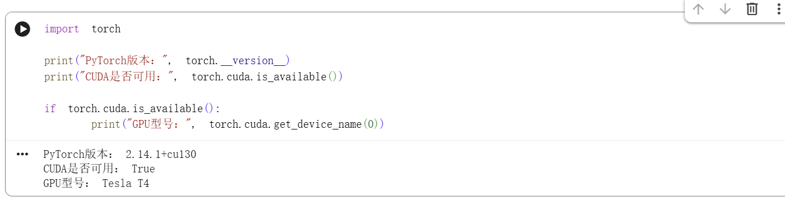

# LoRA-SODA-Dialogue-Evaluation

## 1. 项目简介

本项目是机器学习课程实验，主要研究使用 LoRA（Low-Rank Adaptation）微调语言模型，并在 SODA 对话数据集上进行测试。

实验采用 WenZhong-GPT2-110M 作为基础模型，加载已经训练完成的 LoRA 适配器，对基础模型和 LoRA 模型进行相同测试，并比较两者的评价指标。

**实验信息：**
- 姓名：张睿雅
- 学号：2026710817
- 实验平台：Google Colab
- GPU：NVIDIA Tesla T4
- 基础模型：WenZhong-GPT2-110M
- 微调方法：LoRA
- 测试数据集：SODA

## 2. 实验目的

1. 准备基础语言模型和 LoRA 适配器。
2. 获取并处理 SODA 对话测试数据。
3. 在 GPU 环境下加载基础模型和 LoRA 权重。
4. 对两个模型进行相同的对话测试。
5. 比较模型损失、困惑度、文本多样性和精确匹配等指标。

## 3. 实验结果

本次共提取 50 条 SODA 测试样本，其中 1 条因对话结构异常被跳过，最终获得 49 条有效测试样本。

| 评价指标 | 基础模型 | LoRA 模型 |
|---|---:|---:|
| Answer Loss ↓ | 3.605712 | 3.588661 |
| Perplexity ↓ | 36.807892 | 36.185602 |
| Distinct-1 ↑ | 0.380165 | 0.138093 |
| Distinct-2 ↑ | 0.524027 | 0.294000 |
| Exact Match ↑ | 0.000000 | 0.000000 |

实验结果表明，LoRA 模型在 Answer Loss 和 Perplexity 上有所改善，但文本多样性指标有所下降。

## 4. 项目文件结构

```text
LoRA-SODA-Dialogue-Evaluation/
│
├── README.md
├── 机器学习课程实验报告.md
│
├── screenshots/
│   └── screenshots/
│       ├── 01_colab_gpu_environment.png
│       ├── 02_base_model_extracted.png
│       ├── 03_soda_dataset_preview.png
│       ├── 04_soda_test_50_downloaded.png
│       ├── 05_upload_adapter_and_testdata.png
│       ├── 06_lora_adapter_files.png
│       ├── 07_lora_config_and_soda_sample.png
│       ├── 08_lora_training_completed.png
│       ├── 09_base_and_lora_loaded.png
│       ├── 10_test_dialogue_input_reference.png
│       ├── 11_test_skipped_sample_33.png
│       └── 12_final_test_metrics.png
│
└── results/
    ├── comparison_metrics.csv
    └── predictions.json
```

## 5. 实验操作截图

以下为本次实验的 GPU 环境检查截图：



更多实验过程截图请查看 `screenshots/screenshots/` 目录，完整实验过程及分析请查看《机器学习课程实验报告.md》。

## 6. 实验结果文件

- `comparison_metrics.csv`：基础模型与 LoRA 模型的评价指标对比。
- `predictions.json`：模型测试生成结果。

## 7. 总结

本实验完成了基础模型加载、LoRA 适配器加载、SODA 测试数据处理以及两个模型的对比评估，并保存了实验过程截图和测试结果，为分析 LoRA 微调对模型对话表现的影响提供了实验依据。
