# 机器学习课程实验报告：LoRA 微调模型的 SODA 对话测试

**姓名：** 张睿雅  
**学号：** 2026710817  
**提交形式：** Markdown


## 1. 实验目的

1. 准备预训练语言模型及 LoRA 适配器。
2. 使用 SODA 对话数据集构建测试样本。
3. 在 GPU 环境中加载基础模型和 LoRA 适配器。
4. 对基础模型与 LoRA 模型进行相同测试。
5. 对比两个模型的评价指标，分析 LoRA 微调带来的变化。
6. 整理实验代码、测试结果和操作截图，以 Markdown 形式提交至 GitHub。

## 2. 实验环境

本次实验使用 Google Colab 云端环境运行，利用 GPU 完成模型加载和测试。

实验环境信息如下：

| 项目 | 配置信息 |
|---|---|
| 实验平台 | Google Colab |
| 深度学习框架 | PyTorch |
| PyTorch 版本 | 2.14.1+cu130 |
| CUDA | 可用 |
| GPU 型号 | Tesla T4 |
| 基础模型 | WenZhong-GPT2-110M |
| 微调方式 | LoRA |
| 测试数据集 | SODA |

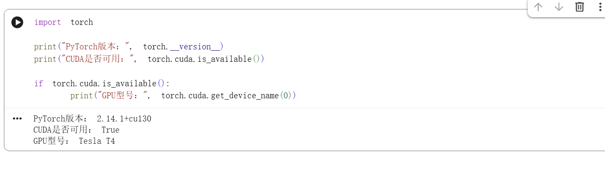

## 3. 模型与数据准备

### 3.1 基础模型准备

本实验使用 WenZhong-GPT2-110M 作为基础语言模型。

首先将模型压缩包上传至 Google Colab，随后进行解压，并检查模型目录中的配置文件、模型权重和 tokenizer 相关文件。

检查结果显示，模型文件完整，主要包括：

- config.json
- model.safetensors
- tokenizer.json
- tokenizer_config.json
- special_tokens_map.json
- merges.txt
- vocab.json

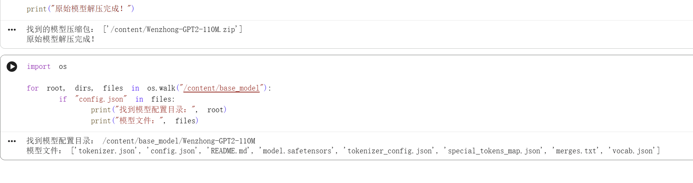

### 3.2 SODA 数据集检索与样本预览

通过 Hugging Face 数据集接口检索 SODA 数据集，并读取数据样本。

数据集包含 head、relation、tail、literal、narrative、dialogue、speakers 等字段。

本次实验主要使用其中的多轮对话内容及说话人信息，构建模型测试输入。

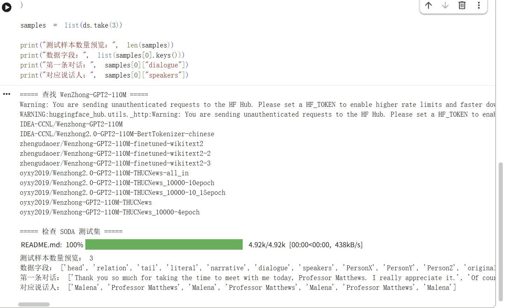

随后从 SODA 数据集中提取 50 条测试样本，并保存为 JSONL 文件，文件名称为：

`soda_test_50.jsonl`

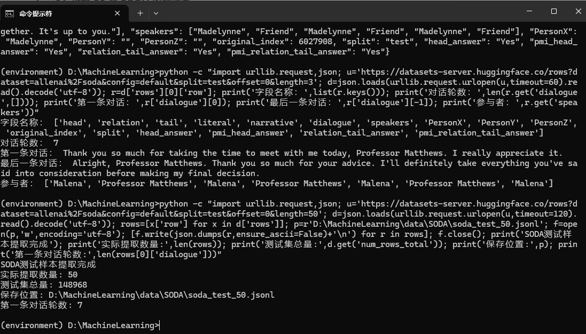

### 3.3 上传测试文件与 LoRA 适配器

将已经训练完成的 LoRA 适配器压缩包 `final_adapter.zip` 和测试数据文件 `soda_test_50.jsonl` 上传至 Colab 环境，为后续模型加载和测试做好准备。

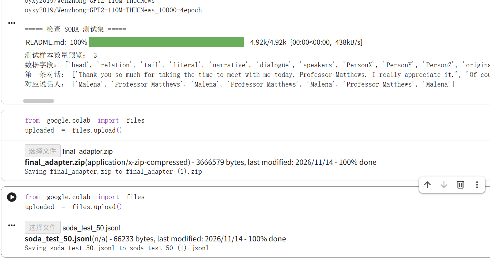

上传完成后，对 LoRA 适配器目录进行检查。

适配器目录中包含以下主要文件：

- adapter_model.safetensors
- adapter_config.json
- tokenizer.json
- tokenizer_config.json
- README.md

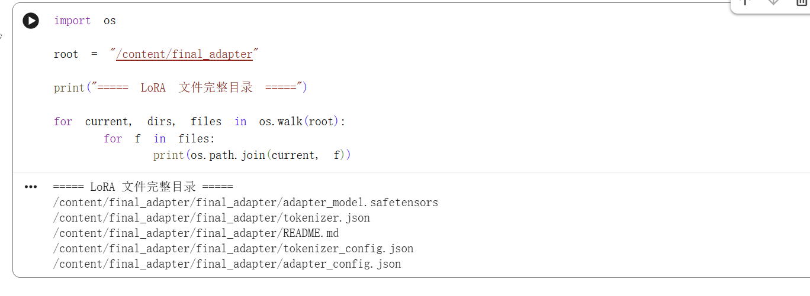

### 3.4 LoRA 配置与测试样本结构

通过读取适配器配置文件，获得当前 LoRA 模型的主要参数：

| 参数 | 配置 |
|---|---|
| 任务类型 | CAUSAL_LM |
| Rank | 8 |
| Target Modules | c_attn、c_proj |

同时检查 SODA 测试样本的对话结构，确认对话轮数及说话人信息能够正常读取。

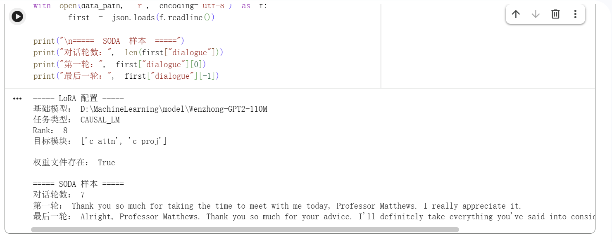

## 4. LoRA 微调记录

此前的训练日志显示，LoRA 微调任务已经完成 3 个 Epoch。

训练日志记录的主要结果如下：

| 指标 | 数值 |
|---|---:|
| Train Loss | 0.9336 |
| Val Loss | 0.862 |
| Perplexity | 2.368 |
| Epoch | 3 |

训练完成后，LoRA 适配器及相关训练记录文件已保存。

需要说明的是，本节记录的是此前的模型训练过程，而后续实验主要评价已经训练完成的适配器在 SODA 测试样本上的表现，二者属于不同实验阶段。

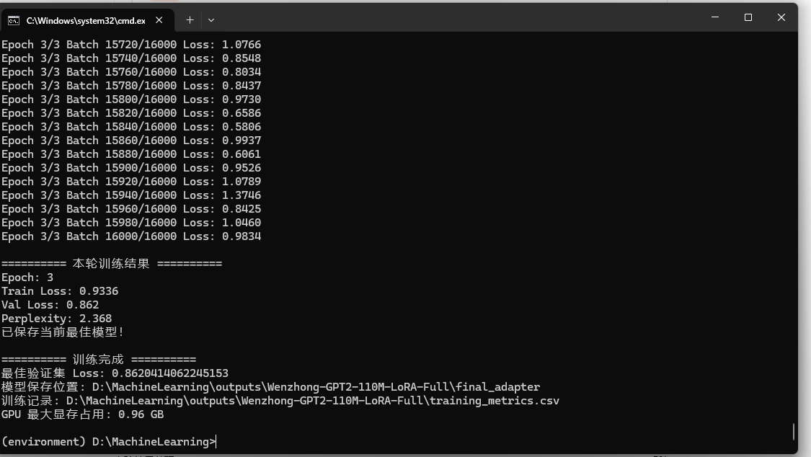

## 5. 模型加载与测试过程

### 5.1 加载基础模型和 LoRA 权重

首先加载 WenZhong-GPT2-110M 基础模型，然后在基础模型上加载 LoRA 适配器权重。

程序运行日志显示：

- 基础模型加载成功。
- LoRA 权重加载成功。
- GPU 设备为 Tesla T4。
- 两个模型均已准备完成。

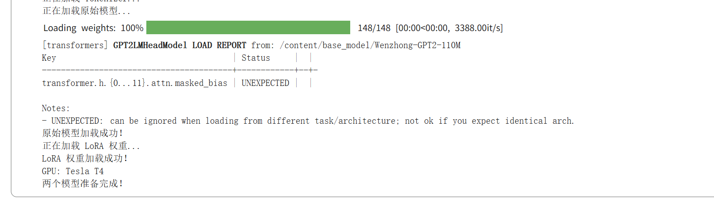

### 5.2 构造模型输入与参考答案

从 SODA 测试样本中提取前面的多轮对话作为模型输入，将最后一轮对话作为参考答案。

通过这种方式，使基础模型和 LoRA 模型使用相同的对话上下文进行测试，并使用相同的参考答案计算评价指标。

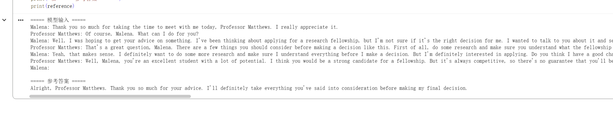

### 5.3 异常样本处理

在测试过程中，程序发现第 33 条样本存在对话轮数与说话人数量不一致的问题。

为避免异常数据影响实验评价，程序对该条样本进行了跳过处理，并继续执行后续测试。

最终，两个模型均在相同的 49 条有效样本上完成评估。

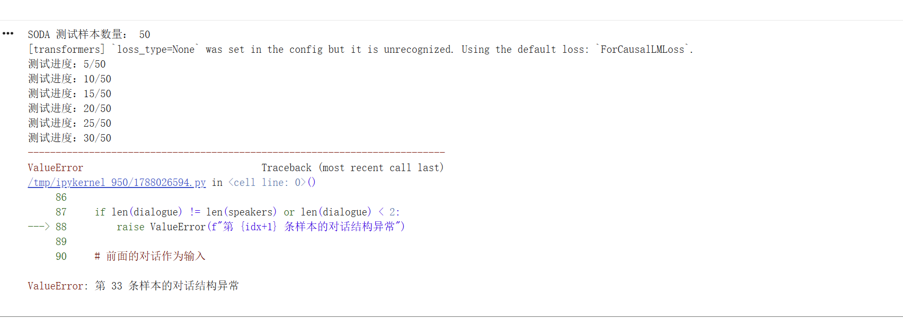

## 6. 实验结果与分析

### 6.1 测试结果

本次 SODA 测试共读取 50 条样本，其中 1 条因对话结构异常被跳过。

最终，基础模型和 LoRA 模型均完成了 49 条有效样本的测试。

两个模型的评价指标如下：

| 评价指标 | 基础模型 Base | LoRA 模型 |
|---|---:|---:|
| Answer Loss ↓ | 3.605712 | 3.588661 |
| Perplexity ↓ | 36.807892 | 36.185602 |
| Distinct-1 ↑ | 0.380165 | 0.138093 |
| Distinct-2 ↑ | 0.524027 | 0.294000 |
| Exact Match ↑ | 0.000000 | 0.000000 |

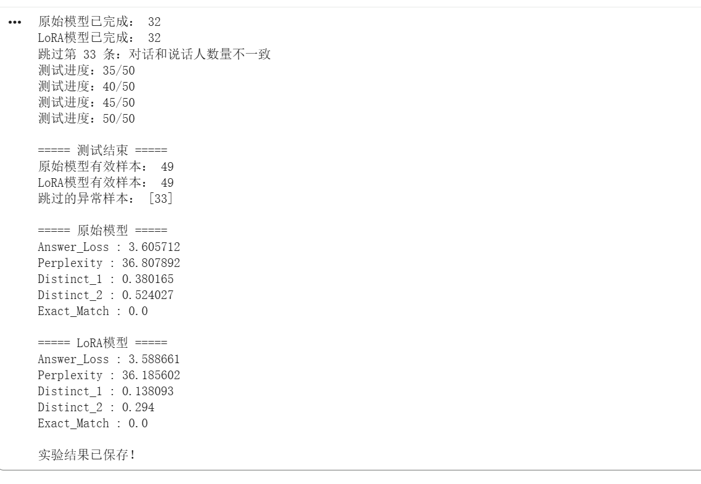

### 6.2 结果分析

根据实验结果，可以得到以下结论：

**（1）Answer Loss 指标**

基础模型的 Answer Loss 为 3.605712，LoRA 模型为 3.588661。LoRA 模型的损失值有所下降，说明在当前测试设置下，其预测参考答案的损失表现略有改善。

**（2）Perplexity 指标**

基础模型的 Perplexity 为 36.807892，LoRA 模型为 36.185602。该指标同样有所下降，与 Answer Loss 的变化趋势一致。

**（3）文本多样性指标**

基础模型的 Distinct-1 和 Distinct-2 分别为 0.380165 和 0.524027，而 LoRA 模型分别为 0.138093 和 0.294000。

LoRA 模型的两个多样性指标均有所下降，说明其生成文本的词汇和短语多样性表现不如基础模型。

**（4）Exact Match 指标**

两个模型的 Exact Match 均为 0。这表明在当前严格匹配评价方式下，没有生成结果与参考答案完全一致。

由于开放式对话存在多种合理表达方式，因此 Exact Match 不能单独作为判断对话质量的依据。

**综合分析：**

从本次实验结果来看，LoRA 模型在 Answer Loss 和 Perplexity 两项指标上取得了小幅改善，但在 Distinct-1 和 Distinct-2 两项指标上出现下降。

因此，不能简单认为 LoRA 微调使模型的所有性能指标都得到了提升。不同指标反映了模型表现的不同方面，还需要结合具体生成文本进行进一步分析。

## 7. 实验总结

本次实验完成了 WenZhong-GPT2-110M 基础模型和 LoRA 适配器的准备、SODA 测试数据提取、GPU 环境下的模型加载，以及基础模型与 LoRA 模型的对比测试。

实验共读取 50 条测试样本，其中 49 条有效样本参与了两个模型的共同评价。

从测试结果来看，LoRA 模型在 Answer Loss 和 Perplexity 上有一定改善，但文本多样性指标有所下降。这说明模型微调后的性能变化并不是单一方向的，需要结合不同评价指标进行综合判断。

通过本次实验，进一步熟悉了预训练语言模型的加载、LoRA 适配器的使用、对话数据处理以及语言模型评价指标的计算过程，也加深了对模型微调与性能评估的理解。

## 8. 项目文件结构

本次 GitHub 仓库主要包含实验报告、操作截图和项目说明文件。

```text
LoRA-SODA-Dialogue-Evaluation/
│
├── README.md
├── 机器学习课程实验报告.md
│
└── screenshots/
    ├── .gitkeep
    │
    └── screenshots/
        ├── 01_colab_gpu_environment.png
        ├── 02_base_model_extracted.png
        ├── 03_soda_dataset_preview.png
        ├── 04_soda_test_50_downloaded.png
        ├── 05_upload_adapter_and_testdata.png
        ├── 06_lora_adapter_files.png
        ├── 07_lora_config_and_soda_sample.png
        ├── 08_lora_training_completed.png
        ├── 09_base_and_lora_loaded.png
        ├── 10_test_dialogue_input_reference.png
        ├── 11_test_skipped_sample_33.png
        └── 12_final_test_metrics.png
```

